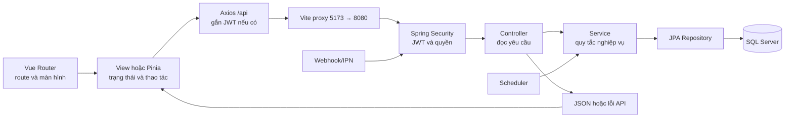
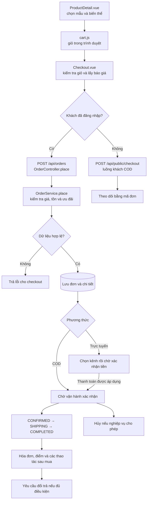
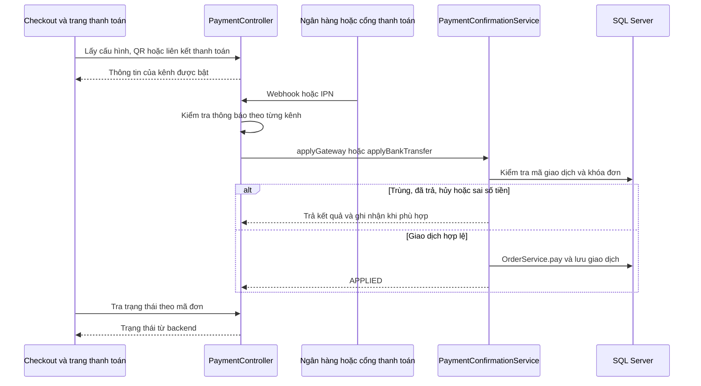
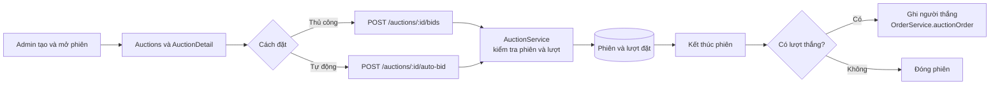
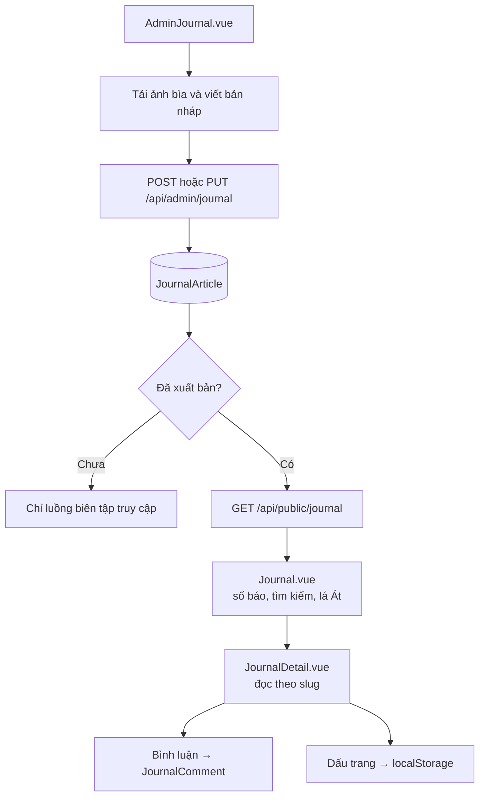

# Luồng xương sống CarShowroom

## Một lần bấm đi qua những tầng nào

Một số controller xử lý nghiệp vụ trực tiếp. Mở `frontend/src/router.js`, `frontend/src/api.js`, `frontend/vite.config.js`, rồi tra lớp tương ứng trong `backend/src/main/java/com/ares/shop`. Frontend đọc JSON hoặc hiện lỗi từ backend. Tác vụ nền và thông báo thanh toán có thể đi vào hệ thống mà không cần mở trang.

## Vòng đời đơn hàng

Không xem số tiền hiển thị trong giỏ là số cuối cùng. Đọc nhánh ký tên trong `Checkout.vue`, handler tương ứng và `service/OrderService.java` để biết backend tái kiểm tra những gì. Phần admin nằm ở `AdminOrders.vue`, `AdminOrderDetail.vue` và `AdminReturns.vue`.

## Xác nhận tiền về

VietQR và các kênh dùng thông báo xác thực để cập nhật đơn. Kênh cổng yêu cầu số tiền chính xác trong hàm đối soát chung. Chuyển khoản ngân hàng bị từ chối khi thiếu tiền. Giao dịch trùng chạy song song có nhánh rollback. Luồng chuyển trang về và luồng xác nhận tiền là hai sự kiện có thể đến khác thời điểm.

## Đấu giá

Đối chiếu `AuctionController.java`, `AuctionService.java` và `AutoBidBox.vue`. URL trong trình duyệt là `/auctions`. Endpoint Spring có tiền tố `/api`.

## Báo ARES

Tính năng báo ở `frontend/src/views/Journal.vue` và `JournalDetail.vue`. `journal.css` giữ bố cục in báo. `JournalController.java` phân biệt quyền đọc bài nháp và bài công khai. SQL Server chạy chuyển đổi cột lưu tiếng Việt qua `JournalUnicodeMigration.java`.

## Quyền và công việc chạy nền

| Nhánh | Luồng lần theo |
|---|---|
| Tài khoản | Login hoặc OAuth → backend cấp JWT → Pinia giữ phiên → Axios gắn token → Spring Security đọc token |
| Quyền nhân viên | Route admin kiểm tra quyền vào trang → API kiểm tra role → StaffPermissionInterceptor kiểm tra nhóm chức năng |
| Tác vụ nền | Scheduler → JobService → tạo JobRun → admin xem kết quả trong /admin/jobs |
| Ưu đãi và giữ chân | Voucher/flash sale thay đổi điều kiện checkout. Giỏ đồng bộ và tác vụ nhắc giỏ có thể hoạt động độc lập |
| Kho và POS | Admin tạo hàng/biến thể → nhập hoặc điều chỉnh tồn → POS hoặc đơn web → kiểm tra số liệu và lịch sử |
| Xưởng và cộng đồng | Khách gửi yêu cầu hoặc dữ liệu chia sẻ → controller của nhánh → admin duyệt hoặc cập nhật khi có bước vận hành |
